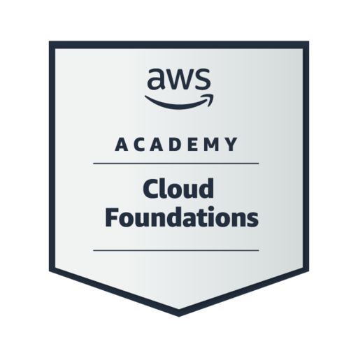
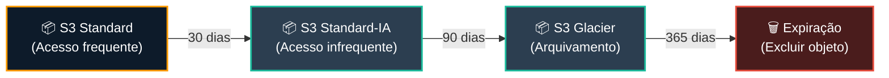
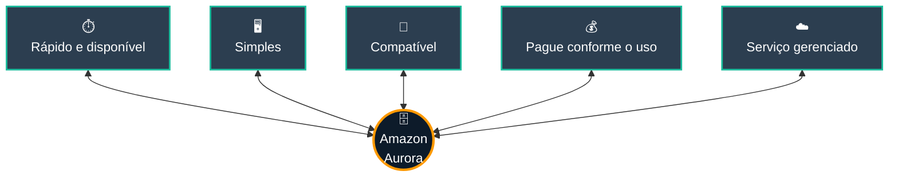
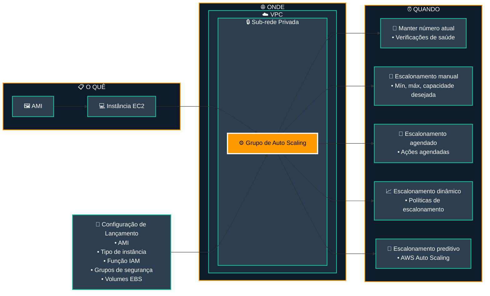

# AWS Academy Cloud Foundations

## Sobre o curso

O **AWS Academy Cloud Foundations** apresenta os conceitos fundamentais da computação em nuvem e os principais serviços da AWS, preparando os estudantes para compreender arquiteturas em nuvem e desenvolver soluções utilizando a infraestrutura da Amazon Web Services.

Durante o curso são explorados temas como:

- Conceitos de Computação em Nuvem
- Economia e faturamento da AWS
- Infraestrutura Global da AWS
- Segurança na Nuvem
- Redes e Amazon VPC
- Computação com Amazon EC2
- Armazenamento em Nuvem
- Bancos de Dados Gerenciados
- Arquitetura de Soluções
- Monitoramento e Auto Scaling

---

    
<h2><b>Indice</b>

- [Módulo 1 — Fundamentos de computação em nuvem](#módulo-1)
- [Módulo 2 — Economia e custos da AWS](#módulo-2)
- [Módulo 3 — Infraestrutura global e serviços AWS](#módulo-3)
- [Módulo 4 — Segurança, IAM e conformidade](#módulo-4)
- [Módulo 5 — Redes e Amazon VPC](#módulo-5)
- [Módulo 6 — EC2, contêineres e computação](#módulo-6)
- [Módulo 7 — Armazenamento: EBS, S3 e EFS](#módulo-7)
- [Módulo 8 — Bancos de dados e serviços gerenciados](#módulo-8)
- [Módulo 9 — Arquitetura e Well-Architected Framework](#módulo-9)
- [Módulo 10 — Elastic Load Balancing e Auto Scaling](#módulo-10)

# **Módulo 1**

Computação em nuvem é a entrega sob demanda de recursos de TI via internet com preços *pagos pelo uso*.

Quase tudo que você pode implementar com TI tradicional pode ser implementado como um serviço de computação em nuvem da AWS.

## **Modelos de serviços em nuvem**

- Recursos de **rede IaaS "Infraestrutura como serviço"**: hardware ou VMs e espaço de armazenamento de dados
- **PaaS "Plataforma como serviço"**: não precisa gerenciar a infraestrutura subjacente de hardware ou software
- Produtos **SaaS "Software como serviço"** que podemos usar (aplicações para usuários finais)

## **Modelos de implantação em computação em nuvem**

- **Nuvem**
    
    Todas as partes da aplicação rodam na nuvem; podem ser construídas usando infraestrutura de baixo nível ou serviços de alto nível que forneçam abstração dos requisitos de gestão, arquitetura e escalonamento da infraestrutura central.
    
- **Híbrido**
    
    Permite que as organizações expandam e ampliem sua infraestrutura para a nuvem, ao mesmo tempo em que conectam recursos em nuvem a sistemas internos "geralmente entre a nuvem e a infraestrutura local existente".
    
- **Nuvem privada ("on-premises")**
    
    Fornece recursos dedicados usando virtualização e ferramentas de gerenciamento de recursos.
    

---

#### **Semelhanças entre AWS e TI tradicional**

- Grupos de segurança AWS, ACLs de rede, AWS Identity e IAM >< firewalls, ACLs e administradores
- Balanceamento de carga elástico, roteadores de >< VPC da Amazon, pipelines de rede e switches
- AMIs e servidores Amazon EC2 >< On-Premises
- Amazon EBS, Amazon EFS, Amazon S3 e Amazon RDS >< DAS, SAN, NAS e RDBMS

---

## **O que é AWS?**

**A AWS** é uma "plataforma de nuvem segura" que oferece um amplo conjunto de produtos globais baseados em nuvem, oferece flexibilidade e acesso sob demanda a muitos recursos de TI e ferramentas de gerenciamento.

### **Exemplo simples de uma aplicação de banco de dados**

Os clientes enviam dados para instâncias Amazon EC2. Servidores

EC2 agrupam os dados e adicionam um objeto por cliente ao Amazon S3.

Para construir um índice, podemos usar um banco de dados simples e não relacional como o Amazon DynamoDB.

Podemos rodar esses serviços dentro de uma Amazon Virtual Private Cloud (VPC).

### **Serviços**

- **EC2**, controle sobre seus recursos computacionais AWS
- **Lambda**, rodar código sem se importar com manutenção de servidores
- **Elastic Beanstalk**, implante, gerencie e escale aplicações web
- **Lightsail**, plataforma leve em nuvem para aplicações web simples
- Gerencie e execute centenas de milhares de cargas de trabalho em **lote**
- **Outposts**, rodem infraestrutura AWS no seu data center local
- **ECS**, "serviço *de contêineres* elásticos"
- **EKS**, "serviço *elástico de Kubernetes*"
- **Fargate**, implemente uma arquitetura de contêineres ou *microserviços*
- **VMware Cloud**, migre para a AWS sua plataforma de virtualização de servidores on-premises

### **Interaja com a AWS**

- **Console de gerenciamento**, interface gráfica presente na AWS
- **Interface de linha de comando**, script de comando que pode ser usado localmente
- **SDKs**, pacotes para acessar a AWS

---

## **Framework de Adoção em Nuvem AWS**

**O AWS CAF** fornece orientações e melhores práticas para ajudar as organizações a construir uma arquitetura de computação em nuvem em toda a organização e ao longo do ciclo de vida de TI.

### **Perspectivas**

- Do ponto de vista empresarial, stakeholders empresariais podem usar o CAF para criar um forte caso de negócios para a adoção da nuvem.
- **Pessoas**
    
    CAF podem ser usadas para avaliar estruturas organizacionais e funções, novas habilidades e requisitos de processos, além de identificar lacunas.
    
- **Governança**
    
    Foque nas habilidades e processos necessários para alinhar a estratégia e os objetivos de TI com a estratégia e objetivos de negócios.
    
- **O CAF da Plataforma**
    
    Inclui princípios e padrões para implementar novas soluções na nuvem e para migrar cargas de trabalho locais para a nuvem.
    
- **O CAF de Segurança**
    
    Permite estruturar a seleção e implementação de controles de segurança que atendam às necessidades da organização.
    
- **Operações**
    
    Defina os procedimentos operacionais atuais, a fim de identificar as mudanças de processo e o treinamento necessários para implementar a adoção bem-sucedida da nuvem.
    

---

# **Módulo 2**

Pague apenas pelos serviços que você consome; existem muitas formas de pagar menos, você pode usar **Instâncias Reservadas** (em formato de pacote): *AURI, PURI e NURI*.

Também há muitos descontos "baseados em volume", baseados no aumento do uso. Por exemplo, o preço do S3 é escalonado, então você paga menos por GB quando usa mais.

Existem 3 fatores fundamentais de custo na AWS:

- **Computação**: cobrada por hora/segundo, varia conforme o tipo de instância
- **Armazenamento**: cobrado por GB
- **Transferência de dados**: cobrada por GB

---

#### **Nível AWS Free**

[Serviços gratuitos em nuvem AWS](https://aws.amazon.com/it/free/?all-free-tier.sort-by=item.additionalFields.SortRank&all-free-tier.sort-order=asc&awsf.Free%20Tier%20Types=*all&awsf.Free%20Tier%20Categories=*all)

---

### **Serviços gratuitos**

- **VPC**
- **IAM**
- **Escalonamento automático**
- **Elastic Beanstalk**
- **CloudFormation**
- **OpsWorks**

---

### **On-premises vs Nuvem**

A diferença entre esses dois está em como são implantados.

- A infraestrutura *on-premises* é *instalada localmente* no computador e servidores da empresa.
    - **Custos fixos / despesas de capital** como instalações, hardware, licenças e manutenção
    - **Difícil de escalar**
- A infraestrutura *em nuvem* é adquirida de um provedor de serviços, então não há despesas de capital e há custos apenas para novas ferramentas ou atualizações (escalabilidade).

#### **Custo Total de Propriedade (TCO)**

É a estimativa financeira para ajudar a identificar custos *diretos* e *indiretos* de um sistema.

É útil **comparar** os custos de rodar um ambiente de infraestrutura inteiro ou carga de trabalho específica na AWS ou usar uma solução local.

Pode ser um bom indicador para **orçamentar** e construir o business case para migrar para a nuvem.

#### **Parâmetros:**

- **Custos do servidor**
- **Custos de armazenamento**
- **Custos de rede**
- **Custos de mão de obra em TI**

---

### **Calculadora de preços AWS**

Ajuda você a estimar uma conta mensal da AWS, identificar oportunidades de redução de custos, modelar sua solução antes de construí-la e explorar faixas de preço e cálculos.

[https://calculator.aws/#/](https://calculator.aws/#/)

#### **Custo total de propriedade da nuvem (CTCO)**

Define o que será gasto na tecnologia após a adoção, ou quanto custa rodar a solução. Diferente do TCO, porque o custo total de propriedade é usado para soluções on-premises.

#### **Parâmetros:**

- **soft saving**: reutilização de serviços ou aplicações, aumento da produtividade dos desenvolvedores, processos *de negócios ágeis* e ampliação do alcance global
- **economias pesadas**: redução de custos de servidores, armazenamento, custos de rede e pessoal

---

## **Organizações AWS**

É um serviço gratuito de gerenciamento de contas que permite consolidar várias contas AWS em uma **organização** que você cria e gerencia.

#### **Terminologia**

- **Unidades organizacionais** (OU) são contêineres para contas que podem conter outras OUs. Podemos definir diferentes políticas para OUs ou Contas; cada política afetará todas as crianças.

#### **Utilidades da organização**

- **Políticas de controle de serviços** (SCPs) permitem controlar serviços AWS em múltiplas contas AWS, **isso não substitui o IAM**
- **Grupos de conta**, OUs
- **Sistema de pagamento único**, podemos pagar uma única conta para todas as contas
- **API** para gerenciar e controlar contas

Você pode ver mais sobre "Configurar uma organização" e "simulador IAM[" aqui](https://docs.aws.amazon.com/IAM/latest/UserGuide/access_policies_testing-policies.html)

---

# **Módulo 3**

A infraestrutura AWS Cloud é construída em **torno de Regiões**; existem 22 regiões no mundo todo. Uma Região AWS é uma localização geográfica física com uma ou mais *Zonas de Disponibilidade* (data centers).

Uma empresa pode replicar dados entre Regiões; essa decisão é baseada em governança de dados e exigências legais. É importante considerar a **latência**; você pode [usar isto](https://www.cloudping.info/).

## **Serviços fundamentais AWS**

- **Computação**
    - **EC2**, atua como máquinas virtuais na nuvem.
    - **O autoscaling EC2** permite criar ou remover instâncias EC2.
    - **ECS**, é um serviço *poderoso de organização de contêineres* que suporta contêineres Docker.
    - **ECR** é um *registro de contêineres Docker*, para armazenar, gerenciar e implantar facilmente imagens de contêineres Docker.
    - **Elastic Beanstalk** permite implantar e escalar aplicações web e serviços, usando *Apache* e *Microsoft IIS*.
    - **Lambda** permite *rodar código* sem gerenciar servidores; você paga apenas pelo tempo de computação.
    - **EKS**, facilita a implantação, gerenciamento e escalabilidade de aplicações containerizadas que usam *Kubernetes*.
    - **Fargate** permite executar containers (ECS) sem precisar gerenciar servidores ou clusters.
- **Networking**
    - **VPC**, permite que você provisione seções logicamente isoladas da AWS Cloud.
    - **O balanceamento de carga elástico** distribui o tráfego de aplicações recebidas entre múltiplos alvos.
    - **O CloudFront** é um *serviço rápido de entrega de conteúdo* (CDN).
    - **Transit gateway**, permite conectar *VPCs com redes locais*.
    - **A Route 53** é um serviço *DNS*.
    - **Conexão direta** permite criar uma *conexão de rede privada dedicada* do seu data center para a AWS.
    - **VPN** da sua rede ou dispositivo para a rede global da AWS.
- **Segurança, Identidade e Conformidade**
    - **IAM**, gerencia o acesso aos serviços e recursos da AWS de forma segura, permitindo *criar e gerenciar usuários e grupos da AWS*.
    - **Organizações** restringem quais serviços e ações são permitidos em suas contas.
    - **Cognito**, *adicione login de cadastro* aos seus aplicativos móveis ou web.
    - **O Artifact** oferece acesso sob demanda a relatórios de segurança e conformidade da AWS.
    - **KMS**, crie e gerencie chaves. *Criptografia* entre os serviços da AWS.
    - **Shield** é uma *proteção DDoS* gerenciada para aplicações na AWS.
- **Armazenamento**
    - **S3**, usado para qualquer quantidade de dados, geralmente para sites, aplicativos móveis, backup e restauração, arquivamento, aplicações empresariais, IoT e análise de big data
    - **EBS**, usado para bancos de dados relacionais e não relacionais, containers, motores de análise de big data, sistemas de arquivos e fluxos de trabalho de mídia.
    - **O EFS**, usado para escalar a demanda para *petabytes*, fornece um *sistema de arquivos de rede elástico* (NFS) para uso com serviços em nuvem AWS e recursos locais.
    - **Serviço simples de armazenamento Glacier**, para arquivamento *de backups de longo prazo*.
- **Banco de dados**
    - **RDS**, permite criar, operar e escalar *bancos de dados relacionais*.
    - **Aurora** é um banco de dados relacional compatível *com MySQL* e *PostgreSQL* (mais eficiente e rápido).
    - **Redshift**, permite executar *consultas analíticas em petabytes de dados* em Redshift, contra *exabytes de dados* em S3.
    - **DynamoDB** é um banco *de dados de chave-valor* e *documento*, com backup e restauração, e cache em memória.

---

# **Módulo 4**

### **Características de serviço e responsabilidade de segurança**

Todo serviço destinado a **ser IaaS**, por exemplo *EC2*, *exige que o cliente execute todas as tarefas necessárias de configuração e gerenciamento de segurança*. Para todo **PaaS**, por outro lado, não é obrigatório.

Para melhores práticas na rodagem de um *Banco de Dados Oracle,* [veja isto](https://docs.aws.amazon.com/whitepapers/latest/oracle-database-aws-best-practices/oracle-database-aws-best-practice.html).

Em resumo, podemos dizer que a AWS é responsável pela segurança **da** nuvem, mas o usuário é responsável pela segurança **na** nuvem.

## **AWS Gerenciamento de Identidade e Acesso (IAM)**

Permite controlar o acesso a serviços de computação, armazenamento, banco de dados e aplicações na AWS Cloud. O IAM pode ser usado para *gerenciar autenticação* e para especificar ou aplicar *políticas de autorização*, a fim de especificar qual usuário pode acessar qual serviço.

**Melhores práticas:** siga o princípio do menor privilégio

#### **Direitos de acesso detalhados**

- **quem** pode acessar o recurso
- **qual** recurso pode ser acessado e o que o usuário pode fazer com ele
- **Como** os recursos podem ser acessados

#### **Componentes**

- **usuário**, pessoa ou aplicação que possa se autenticar com uma conta AWS
- **group**, um conjunto de usuários IAM que recebem autorização idêntica
- **política**, um documento que define *qual recurso pode ser acessado + acesso ao nível de OD*
- **Função**, mecanismo para conceder um conjunto de permissões

#### **Autentique como usuário IAM para obter acesso**

Quando definimos um usuário IAM, também definimos os *tipos de acesso*.

Um usuário pode acessar usando **o Acesso Programático** (API) usando o ID da chave de acesso e a chave de acesso secreta. Ou pode acessar usando uma "página de login" chamada **Management Console Access** usando ID/alias de conta de 12 dígitos e nome de usuário IAM + senha IAM.

Também podemos adicionar **o IAM MFA** para aumentar a segurança.

#### **Políticas**

- **Baseado em identidade**, anexar uma política a qualquer entidade IAM (usuário/grupo/papel), listando todas as ações que uma entidade pode ou não realizar; Uma única política pode ser vinculada a múltiplas entidades e cada entidade pode ter múltiplas políticas.
- **Baseado em recursos**, anexado a um recurso, por exemplo um bucket S3.

Você pode acessar o simulador de políticas [IAM aqui](https://policysim.aws.amazon.com/).

#### **Garantindo uma nova conta AWS**

A conta ROOT usada para criar e gerenciar todos os serviços usados na AWS não pode ser limitada por políticas, então precisamos protegê-la de maneiras diferentes. Para proteger a conta, devemos usá-la somente se for estritamente necessário, permitir o MFA da conta, ativar o CloudTrail para rastrear a atividade dos usuários e monitorar os relatórios de faturamento.

---

## **Programas de conformidade AWS**

Forneça informações sobre as políticas, processos e controles que são estabelecidos e operam pela AWS. Podemos usar ferramentas como **o AWS Config** para avaliar, auditar e avaliar as configurações da AWS; além disso**, o artefato da AWS** pode ser usado para ver relatórios de segurança e conformidade.

---

# **Módulo 5**

## **Noções básicas de redes**

Uma rede de computadores é composta por duas ou mais máquinas clientes que estão conectadas entre si, podendo ser logicamente particionadas em *sub-redes*.

Cada máquina em uma rede possui um endereço IP único, que pode ter **um IPv4** *de 32* bits ou um **IPv6** *de 128 bits*

#### **Roteamento Interdomínio sem classes (CIDR)**

Um endereço CIDR é composto por:

- Endereço **IP**
- **/** "personagem barra"
- **Número**, indica quantos bits do prefixo de roteamento devem ser fixos ou alocados para o identificador de rede

É uma forma de expressar um grupo de endereços IP que são consecutivos entre si. Existem dois tipos especiais:

- *Endereços IP fixos*, por exemplo, representam um único endereço IP, o que pode ser útil quando você quer configurar uma regra de firewall`192.0.2.0/32`
- *A internet*, na qual cada byte é flexível `0.0.0.0/0`

#### **Modelo de interconexão de Sistema Aberto (OSI)**

É um modelo conceitual usado para explicar como os dados viajam por uma rede.

| **Camada** | **#** | **Função** | **Protocolo/Endereço** |
| --- | --- | --- | --- |
| Aplicação | 7 | Meios para uma aplicação acessar uma rede de computadores | HTTP(S), FTP, DHCP, LDAP |
| Apresentação | 6 | Garante que a camada de aplicação possa ler os dados e a criptografia | ASCI, ICA |
| Sessão | 5 | Possibilita troca ordenada de dados | NetBIOS, RPC |
| Transporte | 4 | Protocolos para suportar comunicação host-to-host | TCP, UDP |
| Rede | 3 | Roteamento e encaminhamento de pacotes (roteadores) | IP |
| Enlace de dados | 2 | Transferir dados na mesma rede LAN | MAC |
| Físico | 1 | Transmissão e recepção de fluxos de bits brutos | Sinais |

---

## **Amazon Virtual Private Cloud (VPC)**

Permite que você provisione uma seção logicamente isolada da nuvem AWS onde você pode lançar seus recursos AWS.

- Seleção do *intervalo de endereços IP*
- Criação de *sub-redes*
- Configuração de *tabelas de roteamento* e *gateways de rede*

#### **VPCs**

Cada VPC é *logicamente isolada* das outras VPCs, é dedicada à sua conta AWS, pertence a uma única Região AWS e pode abranger múltiplas Zonas de Disponibilidade

#### **Sub-redes**

*Faixa de endereços IP* que dividem uma VPC, pertencem a uma única Zona de Disponibilidade e podem ser *públicas* ou *privadas*

#### **Endereçamento IP**

Quando você cria uma VPC, você a atribui a um **bloco IPv4 CIDR** (faixa de endereços IPv4 privados); essa faixa não pode ser alterada. Todo bloco CIDR pode ter um **tamanho máximo** de e um **tamanho mínimo** de . Blocos CIDR de sub-redes não podem se sobrepor.`/16/28`

Use esta [referência](https://docs.aws.amazon.com/vpc/latest/userguide/what-is-amazon-vpc.html).

- **endereços IP reservados**, para cada bloco CIDR criado, a AWS reserva:
    - `x.x.x.0` Endereço de rede
    - `x.x.x.1` Comunicação interna
    - `x.x.x.2` Resolução DNS
    - `x.x.x.3` Uso futuro
    - `x.x.x.255` Endereço de transmissão da rede
- **Endereço IP elástico**
    
    Cada endereço IP Elastic está associado a uma conta AWS e pode ser *alocado* e *remapeado* a qualquer momento.
    
    Use esta [referência](https://docs.aws.amazon.com/vpc/latest/userguide/vpc-eips.html).
    
- **endereço IP público**
    
    Pode ser *atribuído manualmente* por meio de um endereço IP Elastic ou *automaticamente* atribuído pelas configurações de endereço IP público de atribuição automática no nível da sub-rede.
    

### **Interface de rede elástica**

É uma *interface de rede virtual* que você pode **conectar** a uma instância para redirecionar o tráfego de rede para ela e **desanexá-la**. Cada instância na sua VPC tem uma interface de rede padrão que recebe um endereço IPv4 privado a partir do intervalo de endereços IPv4 da sua VPC.

Use esta [referência](https://docs.aws.amazon.com/AWSEC2/latest/UserGuide/using-eni.html).

#### **Tabelas de rotas e rotas**

Uma tabela de rotas contém um conjunto de regras/rotas que você pode configurar para direcionar o tráfego de rede da sua sub-rede. Cada rota especifica um destino e um alvo; por padrão, toda tabela de rotas contém uma *rota local* para comunicação dentro da VPC. Cada sub-rede deve estar associada a uma tabela de roteamento (no máximo uma).

Use esta [referência](https://docs.aws.amazon.com/vpc/latest/userguide/VPC_Route_Tables.html).

---

#### **Gateway de Internet**

É um componente de VPC escalável, redundante e altamente disponível que permite a comunicação entre instâncias na sua VPC e a internet. Permite **fornecer um alvo** na tabela de rotas da sua VPC para tráfego roteável pela internet e realizar **a tradução de endereços de rede** para instâncias que receberam endereços IPv4.

Use esta [referência](https://docs.aws.amazon.com/vpc/latest/userguide/VPC_Internet_Gateway.html).

### **Gateway de tradução de endereços de rede (NAT)**

Permite que instâncias em uma sub-rede privada se conectem à internet ou a outros serviços da AWS, mas impede que a internet inicie uma conexão com essas instâncias. Para criar um gateway NAT, você deve especificar a *sub-rede pública* na qual o gateway NAT deve estar. Você também deve especificar um endereço IP Elastic para associar ao gateway NAT, após atualizar a tabela de rotas associada a uma ou mais de suas sub-redes privadas para apontar o tráfego de saída para o gateway NAT.

- [Gateways](https://docs.aws.amazon.com/vpc/latest/userguide/vpc-nat-gateway.html) NAT
- [Instâncias](https://docs.aws.amazon.com/vpc/latest/userguide/VPC_NAT_Instance.html) NAT

---

## **Compartilhamento de VPC**

A conta que possui a VPC **(proprietária)** compartilha uma ou mais sub-redes com outras **contas (participantes)** que pertencem à mesma organização; os participantes podem *visualizar*, *criar*, *modificar* e *excluir* seus recursos de aplicação nas sub-redes compartilhadas com eles.

Prós:

- Separação de funções
- Grupos de segurança

## **Peering VPC**

É uma conexão de rede entre duas VPCs que permite que você roteie o tráfego entre elas de forma privada. Instâncias em qualquer uma das VPCs podem se comunicar entre si como se estivessem dentro da mesma rede.

Restrições:

- Intervalos de endereços IP **não podem se sobrepor**
- **Peering transitivo não é suportado**
- **apenas um** recurso de peering entre as mesmas duas VPCs

Use isto como [referência](https://docs.aws.amazon.com/vpc/latest/userguide/vpc-peering.html).

---

### **AWS Site-to-Site VPN**

Por padrão, as instâncias que você inicia em uma VPC não podem se comunicar com a rede remota.

Para conectar sua VPC à sua rede remota, precisamos criar uma [conexão VPN](https://docs.aws.amazon.com/vpc/latest/userguide/vpn-connections.html).

### **AWS Direct Connect**

A AWS oferece este serviço para estabelecer uma conexão de rede dedicada e privada entre sua rede e um dos [locais de conexão direta da AWS](https://aws.amazon.com/directconnect/), para que possamos reduzir custos de rede, aumentar a taxa de banda e proporcionar uma experiência de rede mais consistente do que as conexões baseadas na internet.

Isso pode ser útil se seu data center estiver localizado longe da sua região AWS.

### **AWS Transit Gateway**

Para conectividade local, você precisa conectar sua VPN a cada VPC individual, o que pode ser muito difícil e lento para muitas máquinas.

Usando o transit gateway, só precisamos *criar* e *gerenciar* uma única conexão do gateway central para cada VPC.

---

## **Endpoints VPC**

É um *dispositivo virtual* que permite conectar sua VPC de forma privada a serviços AWS suportados e serviços endpoint VPC que são alimentados pelo AWS PrivateLink.

- **endpoint VPC da interface**, permite que você se conecte a serviços alimentados pelo [AWS PrivateLink](https://docs.aws.amazon.com/vpc/latest/privatelink/create-interface-endpoint.html)
- **Ponto de Ponta de Gateway**

## **Segurança VPC**

### **Grupo de segurança**

Funciona como um *firewall virtual* para sua instância e controla o tráfego **de entrada** e **saída**. * ~"filtre o tráfego para suas instâncias" *

Todo grupo de segurança tem suas *regras*; grupos padrão **negam todo tráfego de entrada** e **permitem todo tráfego de saída**.

[stateful]

### **Listas de controle de acesso à rede (ACLs de rede)**

Cada VPC pode ter essa camada adicional de segurança, regras semelhantes a "grupos de segurança", cada sub-rede pode ter sua ACL.

Por padrão, **o tráfego de entrada e de saída é permitido**

[stateless]

Use isto como [referência](https://docs.aws.amazon.com/vpc/latest/userguide/vpc-network-acls.html).

---

## **Rota 53 da Amazon**

É um serviço **web DNS do sistema de nomes de domínio**, usado para direcionar usuários finais para aplicações da internet traduzindo nomes em endereços IP numéricos. Conectar solicitações de usuários à infraestrutura rodando na AWS e também fora dela, é usado para verificar a saúde dos seus recursos, oferece fluxo de tráfego e permite registrar nomes de domínio.

Roteamento suportado:

- **Roteamento simples**, uso em ambientes de servidor único
- **Roteamento round robin ponderado**, atribuir pesos a conjuntos de registros de recursos para especificar a frequência
- **Roteamento por latência**, ajude a melhorar suas aplicações globais
- Roteamento **de geolocalização**, roteamento do tráfego baseado na localização dos usuários
- **Roteamento de geoproximidade**, roteamento de tráfego baseado na localização dos seus recursos
- **Roteamento por failover**, faça failover para um site de backup se seu site principal ficar inacessível
- Roteamento **de respostas multivalor**, responder a consultas DNS com até 8 registros saudáveis selecionados aleatoriamente

## **Amazon CloudFront**

É um serviço **CDN de rede de entrega de conteúdo**, é um sistema distribuído globalmente de servidores de cache, *armazena em cache* cópias de arquivos comumente solicitados (conteúdo estático), *entrega* uma cópia local do conteúdo solicitado a partir de uma borda de cache próxima (Point of Presence) e melhora o desempenho e a escalabilidade da aplicação.

- **Rápido e Global**
- **Segurança na Borda**
- **altamente programável**
- **Custo-efetivo**
    
    Preços:
    
    - *Transferência de dados para fora* = volume de dados transferidos para fora
    - *Requisições HTTP(S)* = #HTTP(S) requisições
    - *Solicitações de invalidação* = após inval_req > 1000 $0,005 por caminho
    - *IP dedicado personalizado SSL* = $600 por mês

---

# **Módulo 6**

## **Amazon EC2**

Oferece máquinas virtuais onde você pode hospedar os mesmos tipos de aplicações que executaria em um servidor tradicional On-Premiss. **A nuvem de computação elástica** te dá controle total sobre o *sistema operacional convidado (Win/Linux)* em cada instância; cada instância pode ter um tamanho especificado dentro de uma Zona de Disponibilidade. Você pode lançar instâncias a partir de **AMIs** e também pode controlar o tráfego *de e* *para* as instâncias.

### **Imagem de máquina da Amazon (AMI)**

Fornece informações necessárias para iniciar uma instância EC2; toda instância precisa de uma AMI; você pode usar diferentes AMIs para diferentes tipos de instâncias.

É composto por: **template para o volume raiz** da instância (SO), **permissões de lançamento** para controlar qual conta AWS pode usar a AMI e **mapeamento de dispositivos de bloqueio** que especifica o volume a ser anexado à instância.

**Tipos:**

- **Quickstart**, AMIs Win/Linux fornecidos pela AWS
- **Minhas AMIs**, AMIs criadas pelo usuário
- **AMIs comunitárias**, AMIs compartilhadas por outros
- **AWS Marketplace**, modelos pré-configurados de terceiros

|  | **Propósito Geral**  | **Otimizado para Computação**  | **Otimizado para Memória**  | **Computação Acelerada**  | **Otimizado para Armazenamento**  |
| --- | --- | --- | --- | --- | --- |
| **Tipos de Instância** | a1, m4, m5, t2, t3 | c4, c5 | r4, r5, x1, z1 | f1, g3, g4, p2, p3 | d2, h1, i3 |
| **Caso de Uso** | Amplo | Alto desempenho | Bancos de dados em memória | Aprendizado de máquina | Sistemas de arquivos distribuídos |

Mais informações sobre diferentes [tipos](https://aws.amazon.com/ec2/instance-types/)

Quando você tem mais instâncias EC2, pode usar **grupos de posicionamento** para especificar um critério de posicionamento, por exemplo, "*implantar todas as instâncias na mesma Zona de Disponibilidade*".

---

#### **Configurações de rede**

Você precisa escolher onde quer implantar a instância, selecionando a *Região* de interesse; Toda vez que você lança uma instância, ela terá uma *VPC padrão*, a AWS atribuirá um endereço IP público. Você também pode optar por lançar a instância em uma **VPC não padrão**.

**Endereço IP elástico**

Toda vez que paramos ou terminamos uma instância, um novo endereço IP é associado/usado pela instância. Se quisermos ter o mesmo endereço IP, devemos associar um *endereço IP Elastic*.

---

#### **Anexar papel IAM [opcional]**

Para fazer chamadas de API seguras para outros serviços da AWS, você precisa anexar uma *Identidade AWS* e *um papel IAM* à instância EC2.

#### **Scripts de dados de usuário [opcionais]**

Podemos especificar um *script de dados de usuário* no lançamento da instância, para personalizar o ambiente de execução da instância. Normalmente são scripts bash shell do Linux ou comandos para a janela do Prompt de Comando/PowerShell do Windows.

[Este](https://aws.amazon.com/premiumsupport/knowledge-center/execute-user-data-ec2/) é um exemplo.

---

#### **Especificar armazenamento**

Podemos configurar opções de armazenamento, podemos escolher um **volume raiz** onde o sistema operacional convidado está instalado, e também podemos anexar volumes de armazenamento adicionais. Para cada volume, devemos especificar:

- Tamanho do disco em GB
- Tipo de volume (tipo de SSDs ou HDDs)
- Auto-deleção ao terminar
- Criptografia utilizada

#### **Opções de armazenamento**

- **Armazenamento de Blocos Elásticos (EBS)**
    
    É um serviço de armazenamento em blocos durável de alto desempenho, projetado tanto para *throughput* quanto para carga *de trabalho intensiva em transações*
    
- **EC2 Instance Store**
    
    Armazenamento efêmero ou temporário em nível de bloco para a instância. Estão localizados no disco físico usado pela instância, usados para *dados temporários* como buffers, caches, dados scratch e outros
    
- **Sistema de Arquivos Elásticos (EFS)**
    
    Sistema de *Arquivos de Rede Elástico (NFS)* totalmente gerenciado, construído para escalar sob demanda até petabytes; ele cresce e diminui automaticamente
    
- **Serviço de Armazenamento Simples (S3)**
    
    Serviço de armazenamento de objetos que oferece escalabilidade, disponibilidade de dados, segurança e desempenho; útil para sites, aplicativos móveis, backup e restauração, arquivamento, aplicações empresariais, IoT e análise de big data
    

---

#### **Tags**

Os rótulos são atribuídos a um recurso AWS, *KEY* e *VALUE* opcional; dessa forma podemos anexar metadados a uma instância EC2, para facilitar o filtro, automatização, controle da alocação de custos e selecionar controle de acesso específico.

---

#### **Configurações de grupos de segurança**

É um *conjunto de regras de firewall* que controlam o tráfego de e para a instância; podemos especificar a *origem* e qual *porta* a comunicação de rede pode usar.

---

#### **Par de chaves (conexões SSH)**

Você pode gerenciar e criar um par de chaves de **PublicKey** armazenadas pela AWS e o arquivo **PrivateKey** que você armazena (.pub). Isso permite conexões seguras com a instância.

---

### **Amazon CloudWatch**

Podemos monitorar instâncias EC2, usando métricas *quase em tempo* real e usando os gráficos fornecidos pela *Aba de Monitoramento*; Até 15 meses de dados históricos.

- **Monitoramento básico**
    
    Sem custo adicional, atualizado a cada 5 minutos
    
- **Monitoramento detalhado**
    
    Taxa mensal fixa para 7 métricas pré-selecionadas, a cada 1 minuto
    

Use isto como [referência](https://docs.aws.amazon.com/AWSEC2/latest/UserGuide/using-cloudwatch-new.html).

---

### **Modelos de precificação**

- **Instâncias sob demanda**
    
    Pagamento por hora, sem compromissos de longo prazo, mas elegível para [o nível Gratuito](https://aws.amazon.com/free/)
    
- **Hosts dedicados**
    
    Servidor físico com capacidade total de instância EC2 dedicado ao seu uso
    
- **Instâncias dedicadas**
    
    Instâncias que rodam em uma VPC em hardware dedicado a um único cliente
    
- **Instância reservada**
    
    Você pode reservar capacidade de computação para *um período de 1 ou 3 anos com custo operacional por hora*
    
- **Instâncias Reservadas Programadas**
    
    Você pode adquirir reservas de capacidade que são recorrentes diariamente, semanalmente ou mensalmente, com duração específica de 1 ano
    
- **Instâncias spot**
    
    Permite que você faça lances em instâncias EC2 não utilizadas, o que pode reduzir os custos; O *preço por hora para uma instância à vista depende da oferta e da demanda*
    

---

## **Serviços de contêiner**

#### **O que é um contêiner?**

Containers são um método de *virtualização de sistemas operacionais*, são um ambiente repetível e autônomo, o software roda da mesma forma em diferentes ambientes e é mais rápido de iniciar, parar ou terminar do que uma VM. Os contêineres são criados a partir *de "modelos"* chamados imagem.

#### **O que é Docker?**

É uma plataforma de software que permite construir, testar e implantar aplicações rapidamente; podemos rodar contêineres no Docker.

### **Serviço de Contêineres Elásticos (ECS)**

É um serviço de gerenciamento de contêineres altamente escalável e rápido. Pode *orquestrar* os containers Docker em execução, manter e escalar a frota de nós que rodam seus containers e eliminar a complexidade de montar a infraestrutura.

Para usar o ECS, precisamos criar uma definição de **tarefa** que seja um arquivo de texto que descreva um ou mais contêineres, até um máximo de 10, e também especifique os parâmetros para sua aplicação.

Uma **tarefa** é a instância de uma definição de tarefa dentro de um cluster; todo cluster pode executar mais tarefas. **O agendador de tarefas ECS** coloca tarefas dentro do cluster; cada **cluster ECS** consiste em um grupo de instâncias EC2, cada uma executando um **agente de contêineres ECS**.

#### **Opções do cluster**

Quando criamos um Cluster ECS, podemos escolher criar:

- **Cluster apenas de rede**, alimentado pela AWS Fargate, o cluster será gerenciado pela AWS; dessa forma, só precisamos empacotar a aplicação em contêineres, especificar os requisitos de CPU e memória, definir políticas de rede e IAM e lançar a aplicação.
- **EC2 Linux/Windows + cluster de rede**, devemos escolher rodar como *instâncias On-Demand* ou *instâncias Spot*; precisamos especificar muitos detalhes sobre as instâncias EC2.

### **Registro de Contêineres Elásticos (ECR)**

É um registro de contêineres Docker totalmente gerenciado que facilita para desenvolvedores armazenar, gerenciar e implantar imagens de contêineres Docker.

---

#### **O que é Kubernetes?**

É um software de código aberto para *orquestração de contêineres*, que permite implantar e gerenciar aplicações conteinerizadas em larga escala. Podemos rodar qualquer tipo de aplicação conteinerizada usando o mesmo conjunto de ferramentas tanto em data centers on-premises quanto na nuvem. Os containers são executados em agrupamentos lógicos **chamados pods**; cada pod possui um endereço IP e um único Sistema de Nomes de Domínio (DNS), que o Kubernetes usa para se conectar a serviços entre si e ao tráfego externo.

### **Serviço Kubernetes Elástico (EKS)**

É um serviço gerenciado do Kubernetes que facilita a execução do Kubernetes na AWS sem a necessidade de instalar, operar e manter o painel de controle do seu Kubernetes. Suporta contêineres Linux/Windows, suporta muitos add-ons.

---

## **AWS Lambda**

Suporta muitas linguagens de programação, possui administração totalmente automatizada, alta tolerância a falhas embutida, suporta orquestração de múltiplas funções e possui precificação *pay-per-use*.

#### **Fonte do evento**

Produz eventos que acionam a execução de uma função AWS Lambda. O Lambda também **pode puxar** registros de uma fila do serviço de fila Amazon Simple (SQS) e executar um Lambda para cada mensagem buscada; Lambda também pode ler eventos do DynamoDB.

Use isto como [referência](https://docs.aws.amazon.com/lambda/latest/dg/lambda-services.html).

#### **Configuração da função**

Cada função Lambda tem **um nome**, **ambiente de execução** (por exemplo, python/node) e um **papel de execução** para conceder permissões IAM, permitindo que possamos interagir com outros serviços da AWS. Após a configuração inicial, devemos adicionar um código para ser executado, um gatilho, a memória necessária e, se necessário, também podemos configurar variáveis de ambiente.

---

## **Elastic Beanstalk**

É um PaaS que facilita a *implantação*, *escalabilidade* e *gerenciamento* rápidos das suas aplicações e serviços web. Você só precisa enviar seu código, escolher o tipo de instância, o banco de dados a usar, configurar e ajustar a escala automática, atualizar sua aplicação, acessar os arquivos de log do servidor e ativar o HTTPS no balanceador de carga.

Você paga apenas pelos recursos subjacentes que são usados.

#### **Implantações**

Suporta aplicações web escritas em *Java*, *.NET*, *PHP*, *Node.js*, *Python*, *Ruby*, *Go* e *Docker*, sendo implantado em servidores como Apache, NGINX, Passenger, Puma e Microsoft Internet Information Services.

---

# **Módulo 7**

## **Armazenamento em bloco elástico (EBS)**

Fornece volumes persistentes de armazenamento em bloco para uso com instâncias EC2. Armazenamento persistente é qualquer dispositivo de armazenamento de dados que retém dados após a energia desligada para esse dispositivo [**armazenamento não volátil**]. Todo volume EBS é automaticamente replicado dentro de sua Zona de Disponibilidade.

Permite criar **snapshots em momento** dos seus volumes, e você pode *recriar* um novo volume a partir do snapshot a qualquer momento. Você também pode propagar snapshots para diferentes regiões da AWS. Você também pode **criptografar** sem custo adicional.

Tipos:

|  | **Unidades de Estado Sólido (SSD)** |  | **Unidades de Disco Rígido (HDD)** |  |
| --- | --- | --- | --- | --- |
|  | **Propósito Geral** | **IOPS Provisionadas** | **Otimizado para Throughput** | **Frio** |
| **Tamanho Máximo do Volume** | 16 TiB | 16 TiB | 16 TiB | 16 TiB |
| **IOPS Máximo por Volume** | 16.000 | 64.000 | 500 | 250 |
| **Throughput Máximo por Volume** | 250 MiB/s | 1.000 MiB/s | 500 MiB/s | 250 MiB/s |

Use isto como [referência](https://docs.aws.amazon.com/AWSEC2/latest/UserGuide/ebs-volume-types.html).

---

## **Serviço de Armazenamento Simples (S3)**

É um armazenamento *em nível de objeto*, o que significa que, se você quiser alterar uma parte do arquivo, deve fazer a alteração e então enviar novamente todo o arquivo modificado. Os dados são armazenados como objetos dentro de recursos chamados **de buckets**.

Quando criamos um bucket, ele está associado a uma *região AWS específica*; quando armazenamos dados no bucket, eles são **armazenados de forma redundante em várias instalações da AWS**.

Use isto como [referência](https://aws.amazon.com/s3/).

**Classes de armazenamento**:

- **padrão**, projetado para alta durabilidade, disponibilidade e armazenamento de objetos em desempenho para *dados acessados com frequência*
- **Intelligent-Tiering**, projetado para otimizar custos movendo automaticamente os dados para o nível de acesso mais econômico, sem impacto no desempenho ou sobrecarga operacional; exige uma pequena *taxa mensal de monitoramento e automação por objeto*
- **o acesso padrão-infrequente** (Standard-IA) é usado para dados acessados com menor frequência, mas que requerem acesso rápido quando necessário.
- **Acesso de uma zona pouco** frequente (One Zone-IA), igual ao padrão de IA, mas apenas para 1 zona de disponibilidade
- **Glacier**, é uma solução de baixo custo, com 3 opções diferentes de recuperação que vão de alguns minutos a horas
- **O Glacier Deep Archive**, solução de baixo custo, permite a retenção e preservação digital de longos prazos para dados que podem ser acessados uma ou duas vezes por ano

Use isto como [referência](https://docs.aws.amazon.com/AmazonS3/latest/dev/storage-class-intro.html).

#### **Estilos de URL**

Quando enviamos nossos dados, *criamos* um bucket em uma Região AWS e podemos carregar *objetos* no bucket.

- *Ponto final no estilo bucket path*
    
    `https://s3.ap-northeast-1.amazonaws.com/bucket-name`
    
    Com o código de região e após o nome Bucket
    
- *Endpoint virtual hosted com bucket*
    
    `https://bucket-name.s3-ap-northeast-1.amazonaws.com`
    
    Com nome do bucket e código de região depois
    

---

## **Sistema de Arquivos Elásticos (EFS)**

É um sistema de arquivos simples, escalável e elástico para uso com serviços AWS e recursos On-Premises. Ele foi projetado para crescer e encolher automaticamente.

Funciona bem para big data e análises, fluxos de trabalho de processamento de mídia, gerenciamento de conteúdo, web serving e diretórios domésticos.

#### **Recursos**

No EFS, um sistema de arquivos é o recurso principal; cada sistema possui:

- **ID**
- **Token de criação**
- **Tempo de criação**
- **Tamanho do sistema de arquivos** em bytes
- Número de **alvos de montagem** criados para o sistema de arquivos
    
    Os alvos de montagem são necessários para acessar o sistema de arquivos; devemos associar o alvo de montagem na VPC, que é composto por:
    
    - ID do alvo de montagem
    - ID da sub-rede onde foi criado
    - ID do sistema de arquivos onde foi criado
    - Endereço IP onde o sistema de arquivos pode ser montado
    - Estado do alvo de montagem
- **Estado do sistema de arquivos**
- **Tags**
    
    Úteis para organizar seu sistema de arquivos; você pode atribuir seus próprios *metadados* a cada um dos sistemas de arquivos que criar [par *CHAVE-VALOR*]
    

---

## **S3 Glacier**

É um *serviço de arquivamento de dados* projetado para segurança, durabilidade e custo extremamente baixo. Os dados armazenados no Glacier podem levar várias horas para serem recuperados.

Todo Glacier é composto por:

- **Archive**, qualquer objeto que você armazena no S3 Glacier; é a *unidade base* de armazenamento com um ID e uma descrição
- **Vault**, contêiner para armazenar archives; tem um nome e a Região onde você deseja localizar o vault
- **Vault access policy**, determina quem *pode* e quem *não pode* *acessar* dados armazenados no vault, e qual *operação pode* ou *não pode* ser feita

---

### **Políticas de ciclo de vida**

Permitem excluir ou mover objetos com base na idade.

Use isto para [referência](http://docs.aws.amazon.com/AmazonS3/latest/dev/object-lifecycle-mgmt.html).

---

# **Módulo 8**

## **Serviços não gerenciados**

São normalmente provisionados em porções discretas conforme especificado pelo usuário; você deve gerenciar como o serviço responde a mudanças de carga, erros e situações em que os recursos se tornam indisponíveis.

O benefício de usar um serviço não gerenciado é que você tem mais controle refinado sobre como sua solução lida com mudanças de carga, erros e situações em que os recursos se tornam indisponíveis.

## **Serviços gerenciados**

Exigem que o usuário os configure; exigem menos configuração do que *serviços não gerenciados*. Têm bons recursos, como escalabilidade, tolerância a falhas e disponibilidade, tratados automática e internamente pela AWS.

---

## **Relational Database Service (RDS)**

É um serviço **gerenciado** que configura e opera um banco de dados relacional na nuvem. Você só gerencia a otimização da aplicação; em vez disso, a AWS gerencia a instalação e o patching do SO, o software de banco de dados, backups automáticos e disponibilidade.

A AWS também escala recursos, gerencia energia e servidores e realiza manutenção.

### **Instância de banco de dados**

É um ambiente de banco de dados isolado que pode conter *múltiplos bancos de dados criados pelo usuário*. Os recursos em uma instância de banco de dados são determinados por sua classe de instância de banco de dados, e o tipo de armazenamento é ditado pelo tipo de discos.

### **RDS em uma virtual private cloud (VPC)**

Geralmente o banco de dados é isolado em uma *sub-rede privada* e só é tornado diretamente acessível a instâncias de aplicação indicadas. Lembre-se de que, quando você seleciona a sub-rede, também está escolhendo a *Zona de Disponibilidade* para sua instância de banco de dados.

#### **Implantação Multi-AZ**

Pode ser configurada para **gerar automaticamente uma cópia de standby** da instância de banco de dados em outra *Zona de Disponibilidade* dentro da mesma VPC. As transações são replicadas de forma síncrona para a cópia de standby. Portanto, se a instância principal do banco de dados falhar, *o Amazon RDS* automaticamente coloca a cópia de standby online.

### **Read replicas**

*O RDS* suporta a criação de read replicas para *MySQL*, *MariaDB*, *PostgreSQL* e *Amazon Aurora*. As atualizações feitas na instância de banco de dados de origem são copiadas de forma assíncrona para a instância de read replica. Dessa forma, você pode **reduzir a carga** no banco de dados de origem. Read replicas podem ser criadas em uma Região diferente da do banco de dados primário.

| **Use o Amazon RDS quando sua aplicação exigir:** | **NÃO use o Amazon RDS quando sua aplicação exigir:** |
| --- | --- |
| • Transações complexas ou consultas complexas | • Taxas massivas de leitura/escrita (por exemplo, 150.000 escritas/segundo) |
| • Uma taxa de consulta ou escrita de média a alta — Até 30.000 IOPS (15.000 leituras + 15.000 escritas) | • Sharding devido ao alto tamanho de dados ou demandas de throughput |
| • Não mais do que um único nó de trabalho ou shard | • Requisições e consultas simples de GET ou PUT que um banco de dados NoSQL pode lidar |
| • Alta durabilidade | • Personalização do sistema de gerenciamento de banco de dados relacional (RDBMS) |

---

## **Bancos de dados relacionais**

**RDB** trabalha com dados estruturados organizados por tabelas, registros e colunas. Existem relacionamentos bem definidos entre as tabelas do banco de dados. **SQL** (Structured Query Language). Bancos de dados relacionais podem ter dificuldades para escalar horizontalmente ou trabalhar com dados semiestruturados, e também podem exigir muitos joins para dados normalizados.

## **Bancos de dados não relacionais**

É qualquer banco de dados que não segue o modelo relacional. Eles podem escalar horizontalmente e podem trabalhar com dados não estruturados e semiestruturados.

---

## **DynamoDB**

É um banco de dados **NoSQL** rápido e flexível para todas as aplicações que precisam de latência consistente de milissegundos de um dígito em qualquer escala. A Amazon gerencia toda a infraestrutura de dados subjacente para esse serviço e armazena dados de forma redundante em várias instalações em uma *Região dos EUA* nativa como parte da arquitetura tolerante a falhas. Itens na mesma tabela podem ter atributos diferentes. Pode ter tabelas globais que permitem replicar automaticamente entre Regiões da AWS, criptografia em repouso e TTL de item.

#### **Componentes**

Um DynamoDB tem **tabelas**, que são coleções de dados, **itens**, grupo de atributos que é unicamente identificável, e **atributos**.

**Chaves primárias**:

- **chave de partição**, composta por um único atributo chamado *sort key*
- **chave primária composta**, composta por mais atributos

Use isto para [referência](https://docs.aws.amazon.com/amazondynamodb/latest/developerguide/HowItWorks.CoreComponents.html#HowItWorks.CoreComponents.TablesItemsAttributes).

#### **Particionamento**

À medida que os dados crescem, os dados da tabela são particionados e indexados pela chave primária. Você pode recuperar dados de uma tabela DynamoDB de 2 maneiras diferentes:

- *operação query* aproveita o particionamento para localizar itens efetivamente usando a chave primária
- *scan*, que permite localizar itens na tabela correspondendo condições em atributos não chave

---

## **Redshift**

É um **data warehouse** totalmente gerenciado que torna simples e econômico **analisar** todos os seus dados usando *SQL* padrão e suas ferramentas de business intelligence existentes.

Permite executar consultas analíticas complexas contra petabytes de dados estruturados.

### **Arquitetura de processamento paralelo**

O nó líder gerencia comunicações com programas clientes e toda a comunicação com nós de computação. Ele analisa e desenvolve planos para executar operações de banco de dados para todas as etapas necessárias para obter resultados de consultas complexas. Os nós de computação executam o código compilado e enviam resultados intermediários de volta ao nó líder para agregação final.

---

## **Aurora**

É um *banco de dados relacional* **compatível com MySQL e PostgreSQL** construído para a nuvem. Como serviço totalmente gerenciado, o Aurora é projetado para automatizar tarefas demoradas como provisionamento, patching, backup, recuperação, detecção e reparo de falhas.

---

# **Módulo 9**

#### **Arquitetos de nuvem**

Engajam-se com tomadores de decisão para identificar o objetivo de negócios e as capacidades que precisam ser melhoradas; garantem alinhamento entre os entregáveis tecnológicos de uma solução e os objetivos de negócios.

---

## **Well-Architected Framework**

É um **guia** projetado para ajudar você a construir a infraestrutura mais segura, de melhor desempenho, resiliente e eficiente possível para suas aplicações e cargas de trabalho em nuvem. Fornece um conjunto de perguntas fundamentais e melhores práticas que podem ajudar você a avaliar e implementar suas arquiteturas em nuvem.

Use isto para [referência](https://d1.awsstatic.com/whitepapers/architecture/AWS_Well-Architected_Framework.pdf).

### **Pilares**

- **Excelência Operacional** concentra-se na capacidade de *executar e monitorar sistemas* para entregar valor de negócios e melhorar continuamente processos e procedimentos de suporte.
    
    Princípios de design:
    
    - *Executar operações como código*, definir sua carga de trabalho como código e atualizá-la
    - *Fazer mudanças frequentes, pequenas e reversíveis*, projetar cargas de trabalho para permitir que componentes sejam atualizados regularmente
    - *Refinar procedimentos operacionais frequentemente*, buscar oportunidades de melhorar os procedimentos operacionais
    - *Antecipar falhas*, identificar fontes potenciais de falha para que possam ser removidas ou mitigadas
    - *Aprender com todas as falhas operacionais*, impulsionar a melhoria por meio de lições aprendidas com todos os eventos e falhas operacionais
- **Segurança** concentra-se na capacidade de *proteger informações, sistemas e ativos* enquanto entrega valor de negócios por meio de avaliações de risco e estratégias de mitigação.
    
    Princípios de design:
    
    - *Implementar uma base de identidade forte*, implementar o princípio do **menor privilégio** e impor **separação de funções** com autorização apropriada para cada interação com seus recursos AWS
    - *Habilitar rastreabilidade*, monitorar, alertar ações e mudanças em seu ambiente em tempo real
    - *Aplicar segurança em todas as camadas*, aplicar defesa em profundidade e aplicar controles de segurança a todas as camadas da sua arquitetura
    - *Automatizar melhores práticas de segurança*, para melhorar sua capacidade de escalar com segurança de forma mais rápida e econômica
    - *Proteger dados em trânsito e em repouso*, classificar seus dados em **níveis de sensibilidade** e usar mecanismos como criptografia, tokenização e controle de acesso quando apropriado
    - *Manter as pessoas longe dos dados*, para reduzir o risco de perda ou modificação de dados sensíveis devido a erro humano
    - *Preparar-se para eventos de segurança*
- **Confiabilidade** concentra-se em garantir que uma carga de trabalho execute sua *função pretendida correta e consistentemente* quando esperado.
    
    Princípios de design:
    
    - *Recuperar-se automaticamente de falhas*, monitorar o sistema para indicadores-chave de desempenho e configurar seu sistema para acionar uma recuperação automatizada
    - *Testar procedimentos de recuperação*, testar como seus sistemas falham e validar seus procedimentos de recuperação
    - *Escalar horizontalmente para aumentar a disponibilidade agregada da carga de trabalho*
    - *Parar de adivinhar a capacidade*, monitorar demanda e uso do sistema, e automatizar a adição ou remoção de recursos
    - *Gerenciar mudanças na automação*, usar automação para fazer mudanças na infraestrutura e gerenciar mudanças na automação
- **Eficiência de Desempenho** concentra-se na capacidade de *usar recursos de TI e computação eficientemente* para atender aos requisitos do sistema e manter essa eficiência à medida que a demanda muda ou as tecnologias evoluem.
    
    Princípios de design:
    
    - *Democratizar tecnologias avançadas*, consumir tecnologias como serviço, para permitir que a equipe foque no desenvolvimento do produto em vez do provisionamento e gerenciamento de recursos
    - *Ir global em minutos*, implantar sistemas em **múltiplas Regiões AWS** para fornecer menor latência e melhor experiência do cliente a custo mínimo
    - *Usar arquiteturas serverless*, a fim de remover o fardo operacional de executar e manter servidores para realizar atividades tradicionais de computação
    - *Experimentar com mais frequência*, realizar testes comparativos em diferentes tipos de instâncias, armazenamento e configurações
    - *Considerar simpatia mecânica*, usar a abordagem tecnológica que melhor se alinha ao que você está tentando alcançar
- **Otimização de Custos** concentra-se na capacidade de *evitar custos desnecessários*.
    
    Princípios de design:
    
    - *Implementar gestão financeira em nuvem*, para alcançar sucesso financeiro e acelerar a realização de valor de negócios na nuvem
    - *Adotar um modelo de consumo*, pagar apenas pelos recursos de computação que você precisa
    - *Medir a eficiência geral*, medir a produção de negócios da carga de trabalho e os custos associados à sua entrega
    - *Parar de gastar dinheiro em esforço pesado indiferenciado*, não desperdiçar dinheiro com rack, empilhamento e energia de servidores
    - *Analisar e atribuir despesas*, ter essa capacidade ajuda você a medir o retorno sobre o investimento (*ROI*)

---

## **AWS Trusted Advisor**

É uma ferramenta online que fornece orientação em tempo real para ajudar você a provisionar seus recursos seguindo as melhores práticas da AWS. Examina todo o ambiente AWS e **fornece recomendações em tempo real** em 5 categorias: *Otimização de custos*, *Desempenho*, *Segurança*, *Tolerância a falhas* e *Limites de serviço*.

Use isto para [referência](https://docs.aws.amazon.com/awssupport/latest/user/trusted-advisor-check-reference.html).

---

# **Módulo 10**

## **Elastic Load Balancing**

É um serviço da AWS que **distribui o tráfego de aplicações ou de rede recebido** entre múltiplos alvos em uma *única Zona de Disponibilidade* ou *em várias Zonas de Disponibilidade*.

Escala seu balanceador de carga conforme o tráfego para sua aplicação muda ao longo do tempo.

Tipos:

| **Application Load Balancer** | **Network Load Balancer** | **Classic Load Balancer (Geração Anterior)** |
| --- | --- | --- |
| • Balanceamento de carga de tráfego HTTP e HTTPS | • Balanceamento de carga de tráfego TCP, UDP e TLS onde é exigido desempenho extremo | • Balanceamento de carga de tráfego HTTP, HTTPS, TCP e SSL |
| • Roteia tráfego para alvos com base no conteúdo da requisição
• Fornece roteamento avançado de requisições voltado à entrega de arquiteturas de aplicações modernas, incluindo microsserviços e contêineres | • Roteia tráfego para alvos com base em dados de protocolo IP
• Pode lidar com milhões de requisições por segundo mantendo latências ultrabaixas
• É otimizado para lidar com padrões de tráfego súbitos e voláteis | • Balanceamento de carga entre múltiplas instâncias EC2 |
| • Opera na camada de aplicação (camada 7 do modelo OSI) | • Opera na camada de transporte (camada 4 do modelo OSI) | • Opera tanto na camada de aplicação quanto na camada de transporte. |

Use isto para [referência](https://aws.amazon.com/elasticloadbalancing/features/?nc=sn&loc=2).

Para usar um balanceador de carga, você precisa registrar **alvos em grupos de destino**. O balanceador de carga *realiza verificações de saúde* para monitorar a saúde dos alvos registrados.

Você também precisa especificar um ou mais **listeners**; cada listener é um processo que verifica solicitações de conexão. Ele é configurado com um protocolo e número de porta para conexões do balanceador de carga para os alvos.

### **Monitoramento do balanceador de carga**

- **Métricas do CloudWatch**, permitem recuperar estatísticas sobre pontos de dados como um conjunto ordenado de dados de séries temporais, conhecidos como métricas.
    
    Você também pode configurar **alarmes** com base em limite estático; você escolhe uma métrica do CloudWatch para o alarme observar e o limite para essa métrica.
    
    Veja este [exemplo](https://docs.aws.amazon.com/AmazonCloudWatch/latest/monitoring/AlarmThatSendsEmail.html).
    
- **Logs de acesso**, podem ser usados para capturar informações detalhadas sobre as solicitações feitas ao seu balanceador de carga e armazená-las como arquivos de log.
- **Logs do CloudTrail**, podem ser usados para capturar informações detalhadas sobre as chamadas feitas à interface de programação de aplicações (*API*) do *Elastic Load Balancing* e armazená-las como arquivos de log no *Amazon S3*.

---

## **EC2 Auto Scaling**

É um serviço da AWS que ajuda você a manter a disponibilidade da aplicação e permite **adicionar ou remover automaticamente** instâncias *EC2* de acordo com as condições que você define. Você pode usar *recursos de gerenciamento de frota* do EC2 Auto Scaling para manter a saúde e a disponibilidade da sua frota.

Você também pode adicionar ou remover instâncias EC2 manualmente, em uma programação, em resposta à demanda variável ou em combinação com o AWS Auto Scaling para escalabilidade preditiva.

Use isto para [referência](https://aws.amazon.com/ec2/autoscaling).

#### **Grupos do Auto Scaling**

São uma coleção de instâncias EC2 tratadas como um agrupamento lógico para fins de escalabilidade e gerenciamento automáticos. O tamanho é especificado como *capacidade desejada*.

Você pode especificar o número mínimo de instâncias em cada grupo do Auto Scaling; o EC2 Auto Scaling foi projetado para evitar que seu grupo fique abaixo ou acima do tamanho máximo.

Use isto como [referência](https://docs.aws.amazon.com/autoscaling/ec2/userguide/auto-scaling-groups.html).

Como funciona?

Veja mais sobre [*configurações de lançamento*](https://docs.aws.amazon.com/autoscaling/ec2/userguide/launch-configurations.html).

---
