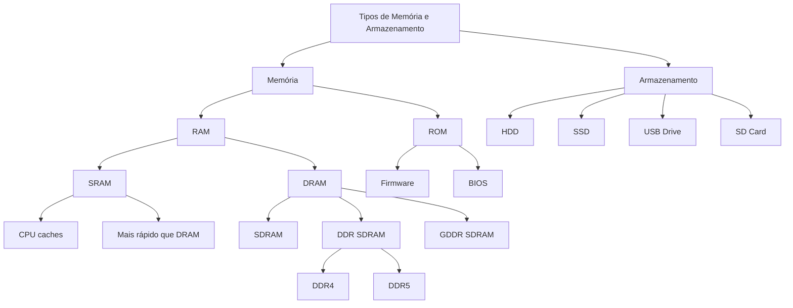

# Memória e Armazenamento - Glossário.

- **RAM (Random Access Memory)**: Memória de acesso aleatório, volátil, usada para armazenar dados temporários enquanto o computador está ligado.

- **ROM (Read-Only Memory)**: Memória apenas de leitura, não volátil, contém instruções permanentes que não podem ser modificadas.

- **SRAM (Static RAM)**: RAM estática que mantém os dados enquanto estiver energizada, sem necessidade de atualização.

- **DRAM (Dynamic RAM)**: RAM dinâmica que precisa ser constantemente atualizada para manter os dados.

- **CPU caches**: Memória de alta velocidade situada entre a CPU e a RAM principal para acelerar o acesso a dados frequentemente usados.

- **SDRAM (Synchronous DRAM)**: DRAM síncrona que opera em sincronia com o clock do sistema.

- **DDR SDRAM (Double Data Rate SDRAM)**: SDRAM que transfere dados tanto na borda de subida quanto na de descida do sinal de clock.

- **GDDR SDRAM (Graphics DDR SDRAM)**: Versão de DDR SDRAM otimizada para placas gráficas.

- **DDR4/DDR5**: Gerações sucessivas de memória DDR com velocidades e eficiências crescentes.

- **Firmware**: Software permanente instalado em dispositivos de hardware para controlar sua operação básica.

- **BIOS (Basic Input/Output System)**: Firmware que inicializa o hardware durante o processo de boot.

- **HDD (Hard Disk Drive)**: Dispositivo de armazenamento não volátil que usa discos magnéticos rotativos.

- **SSD (Solid State Drive)**: Dispositivo de armazenamento não volátil que usa memória flash, sem partes móveis.

- **USB Drive**: Dispositivo de armazenamento portátil que se conecta via porta USB.

- **SD Card (Secure Digital Card)**: Cartão de memória usado em dispositivos portáteis como câmeras e smartphones.

 

